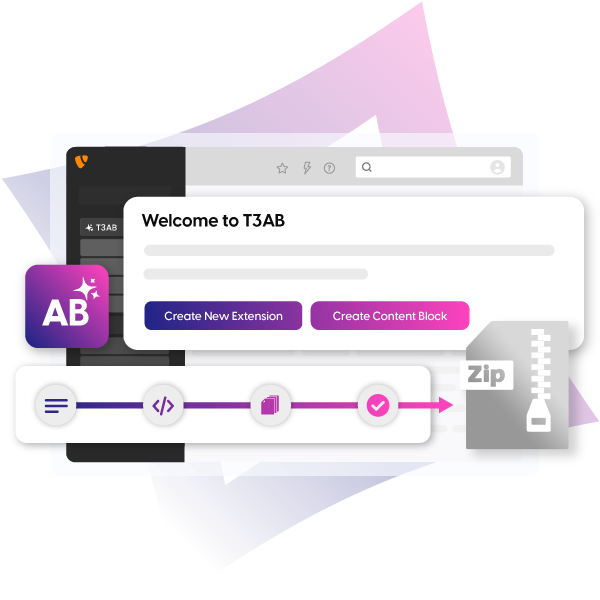

.. include:: Includes.txt

.. _start:

=======================
T3AB - TYPO3 AI Builder
=======================

:Extension key:
   ns_t3ab

:Package name:
   nitsan/ns-t3ab

:Version:
   1.0.0

:Language:
   en

:Author:
   `T3Planet <https://t3planet.de>`__ & TYPO3 contributors

:License:
   GPL-2.0-or-later

:Rendered:
   |today|

----

**T3AB** generates TYPO3 Content Blocks and Form Framework forms in the
backend. Describe the block or the form, choose an AI provider, and use your
own API key. Generated content blocks are stored in a local extension.
Generated forms open in the Form Editor.

   T3AB — TYPO3 AI Builder.

Interactive demos:

*  `T3AB Content Blocks <https://app.supademo.com/demo/cmdyd06zf8l369f96iacjds6b>`__
*  `Create Content Blocks <https://app.supademo.com/demo/cmjvboson9nmf3zz2migyyycc>`__
*  `AI Forms <https://app.supademo.com/demo/cmdycvcmj8koo9f963beq8u9v>`__
*  `Create Forms <https://app.supademo.com/demo/cmjveaijy9okx3zz2ty1an7ku>`__
*  `Configuration <https://app.supademo.com/demo/cmdy6mkbl8a2j9f96fxtfioeu>`__

----

Getting started
===============

..  card-grid::
   :columns: 1
   :columns-md: 2
   :gap: 4
   :class: pb-4
   :card-height: 100

   ..  card:: Introduction

      What the extension does, supported providers and TYPO3 versions.

      ..  card-footer:: :ref:`Read more <introduction>`
         :button-style: btn btn-primary stretched-link

   ..  card:: Quick Installation

      Install with Composer or the Extensions module in a few steps.

      ..  card-footer:: :ref:`Read more <quick-installation>`
         :button-style: btn btn-primary stretched-link

   ..  card:: Quick Configuration

      API key, then the first content block or form.

      ..  card-footer:: :ref:`Read more <quick-configuration>`
         :button-style: btn btn-primary stretched-link

----

For administrators
==================

..  card-grid::
   :columns: 1
   :columns-md: 2
   :gap: 4
   :class: pb-4
   :card-height: 100

   ..  card:: Installation

      Requirements, Composer, classic mode, and Content Blocks versions.

      ..  card-footer:: :ref:`Read more <installation>`
         :button-style: btn btn-primary stretched-link

   ..  card:: Configuration

      API keys and models for every provider, and the package that stores blocks.

      ..  card-footer:: :ref:`Read more <configuration>`
         :button-style: btn btn-primary stretched-link

----

For editors
===========

..  card-grid::
   :columns: 1
   :columns-md: 2
   :gap: 4
   :class: pb-4
   :card-height: 100

   ..  card:: Content Blocks

      Create, preview, save, and delete a content block.

      ..  card-footer:: :ref:`Read more <content-blocks>`
         :button-style: btn btn-primary stretched-link

   ..  card:: AI Forms

      Describe a form, adjust the fields, and open it in the Form Editor.

      ..  card-footer:: :ref:`Read more <ai-forms>`
         :button-style: btn btn-primary stretched-link

----

Help
====

..  card-grid::
   :columns: 1
   :columns-md: 2
   :gap: 4
   :class: pb-4
   :card-height: 100

   ..  card:: Troubleshooting

      Frequently asked questions and solutions for common messages.

      ..  card-footer:: :ref:`Read more <troubleshooting>`
         :button-style: btn btn-primary stretched-link

   ..  card:: Release notes

      What version 1.0.0 includes.

      ..  card-footer:: :ref:`Read more <release-notes>`
         :button-style: btn btn-secondary stretched-link

   ..  card:: Support

      Contact T3Planet support.

      ..  card-footer:: :ref:`Read more <support>`
         :button-style: btn btn-secondary stretched-link

**Table of Contents**

..  toctree::
   :maxdepth: 2
   :titlesonly:

   Introduction/Index
   QuickInstallation/Index
   QuickConfiguration/Index
   Installation/Index
   Configuration/Index
   ContentBlocks/Index
   Forms/Index
   Troubleshooting/Index
   ReleaseNotes/Index
   Support/Index

..  toctree::
    :hidden:

    Sitemap
